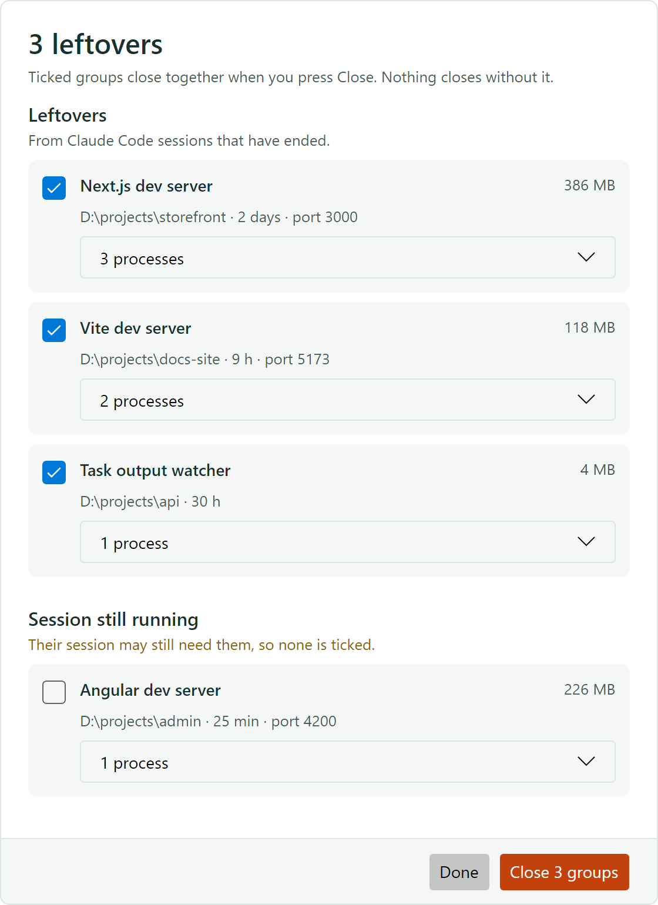
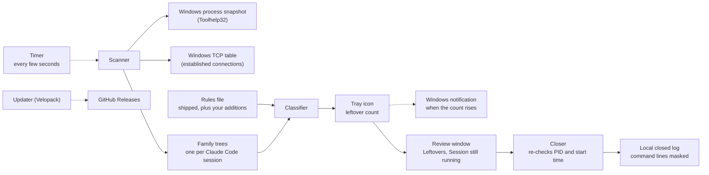
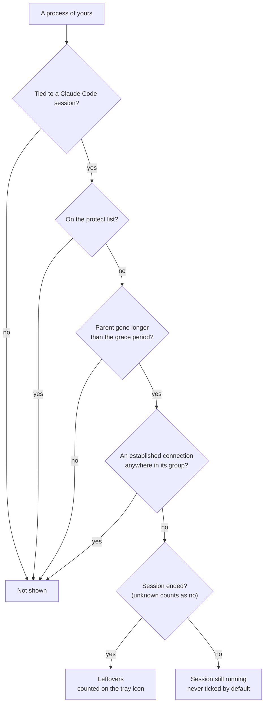

<h1 align="center">
  <picture>
    <source media="(prefers-color-scheme: dark)" srcset="docs/brand/lockup-dark.svg">
    
  </picture>
</h1>

**Sweepling notices the processes your Claude Code sessions left running on Windows, and closes them only after you say so.**

A Claude Code session starts dev servers, file watchers and little scripts. When the session ends, many of them keep running: they hold ports and memory, and they block the next `npm run dev`. Windows doesn't clean them up, and Task Manager lists them as bare `node.exe`, `tail.exe` and `grep.exe` rows with nothing to say which project or session started them.

## Before and after

**Before.** A scan of one machine, 38 hours after boot:

- `next dev --turbopack` holding port 3001 for 35 hours, with nothing connected to it;
- `ng serve --port 4300` running for 11 hours, also idle;
- 20 watchers Claude Code had started: 10 `tail -f` on task output files, 9 `grep --line-buffered` and one `sh` script. Some belonged to a session that had been silent for 22 hours, others to sessions still at work.

**After.** Sweepling sits in the tray and counts the leftovers of sessions that have ended. Its window says what each one is in words, with its project folder, age, port and memory. You close a whole group with one click, and Sweepling re-checks every process right before it closes it.

  <picture>
    <source media="(prefers-color-scheme: dark)" srcset="docs/screenshots/review-dark.png">
    
  </picture>

## What it does

- Every few seconds it takes a snapshot of your processes and keeps a family tree for each Claude Code session.
- It offers a process only when its parent has been gone for a while, it belongs to a Claude Code session, nothing in its group has an open TCP connection or is a windowed app, and it isn't on the protect list.
- Strays of a session that is still running are shown in their own section, never ticked.
- It sees only your own processes and never asks for administrator rights.

**The promise:** Sweepling never closes anything you haven't confirmed, and it doesn't offer anything that still looks in use. When it can't tell whether a session has ended, it treats the session as running.

 

How the classifier sorts one process:

## Install

You need Windows 10 or 11 on x64; Sweepling is tested on Windows 11, and Arm64 PCs run it under emulation.

1. Download `sweepling-setup-win-x64.exe` from the [latest release](https://github.com/hazeliscoding/sweepling/releases/latest).
2. Run it. It installs for your user only and needs no administrator rights. While a release is new, Windows may say "Windows protected your PC": check that the publisher is Hazel Granados, then choose **More info** and **Run anyway**.
3. Sweepling starts in the tray as a straw brush. When the brush shows a count, click it, untick anything you still want, and press **Close**.

Sweepling starts when you sign in and keeps itself up to date; right-click the brush to turn either off. To check a download, compare `(Get-FileHash .\sweepling-setup-win-x64.exe).Hash` with its line in the release's `SHA256SUMS`. To remove it, use **Settings > Apps > Installed apps**: that also removes its login start and settings, and leaves your close log and rules in `%APPDATA%\Sweepling`.

## Status

**In development.** The first release comes after the owner's week of dogfooding, so until then there is nothing to download and the steps above don't work yet. A build from source runs the tray app: it counts leftovers, notifies you when more appear, and closes the groups you tick. `Sweepling.exe --scan > scan.json` lists what it would offer and closes nothing. [ROADMAP.md](ROADMAP.md) has the decisions and milestones. Version one covers the Claude Code CLI only; Codex, Cursor and the Claude desktop app come later.

 

## Alternatives

Checked against their own docs on 2026-10-22.

| | Sweepling (planned) | [cc-reaper](https://github.com/theQuert/cc-reaper) | [kill-port](https://github.com/tiaanduplessis/kill-port) or hand-written commands |
|---|---|---|---|
| Platforms | Windows | macOS and Linux | Any |
| Finds | Each Claude Code session's family tree, plus command-line rules | Orphans in a Claude CLI session's process group, plus command patterns | Whatever holds the port or PID you name |
| Closes | Only a group you confirm | Automatically, from a Stop hook and a daemon that scans every 30 s; its macOS menu bar app asks first | Immediately |
| Dev servers | Offered when orphaned and idle | Protected from its cleanup; an optional hourly reaper can stop one that serves nobody, and only lists them by default | Killed if they hold the port |
| Agents | Claude Code CLI | Claude Code and Codex | Not agent-aware |
| Also does | Nothing else | Disk, worktree and session cleanup, CPU and memory diagnostics | Nothing else |

**When to use something else:** on macOS or Linux, use cc-reaper. It does much more than Sweepling plans to, including automatic cleanup and Codex. If you already know which port is stuck, `npx kill-port 3001` frees it faster than any tray app.

## Contributing

Issues describing a leftover you've seen on Windows are the most useful: what started it, its command line with anything private removed, and how you noticed. [CONTRIBUTING.md](CONTRIBUTING.md) covers building, testing and the rules every change keeps. Report security problems privately, as [SECURITY.md](SECURITY.md) describes.

## License

Apache-2.0. See [LICENSE](LICENSE). Primrose, the café owner in this README, was drawn with an AI image model and is Apache-2.0 like the code. Sweepling is an independent project, not affiliated with or endorsed by Anthropic.
